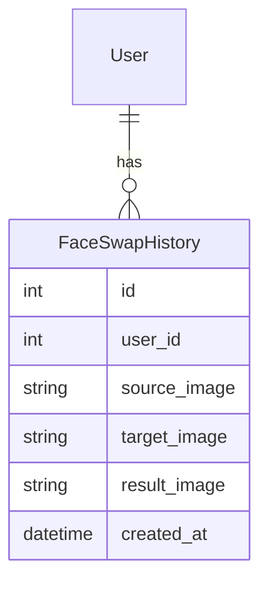
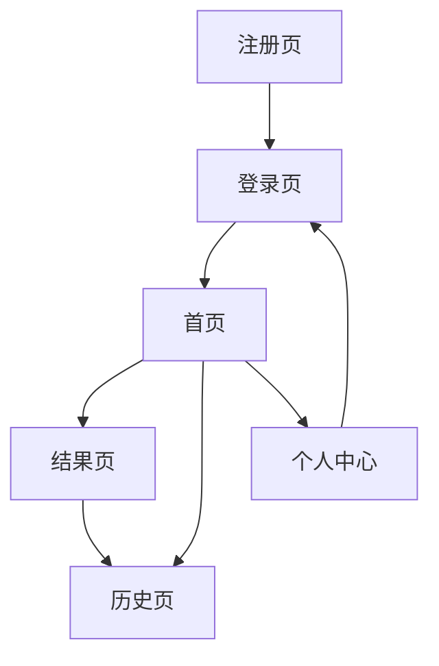

# 今日内容

# 1 ui示意图

## 1.1 回顾软件开发流程

```python
# 1 公司立项： 一键换脸小程序
------------我们+AI编辑器---------------
# 2 产品经理设计：需求：功能
	-产品原型图：专业工具：墨刀-->黑白的
    -我们没有设计原型图
    
# 3 UI部门设计软件界面
	-字体
    -色彩搭配
    -触控反馈
    

# 4 分部门开发
	-软件架构设计：
    	-后端：Python + django + mysql + 表结构设计。。
        -前端：app？小程序？原生开发，框架开发：uniapp
        
	-后端开发：后端
    -前端开发：小程序
# 5 测试

# 6 上线
-----------------------------------
# 7 运营。。。。


############## 上次课#####################
# 1 使用提示词--》生成软件的UI示意图--》一定要会
	-有了UI示意图---》才能开发出软件
```

## 1.1 使用图片-生成UI示意图

```python
# 1 截图别人软件中的界面图--》让Trae仿写
# 2 提示词
参考图片内容:，帮我生成UI示意图。
要求：
1.根据图片展示，生成UI示意图。
2.按照页面单独写入文件：main.html。
3.界面尺寸模拟IPhone17 Pro，让页面圆角化，使其更像真实微信小程序界面。
请按以上要求生成完整的高保真原型图(html)
```


## 1.2 使用手绘图-生成UI示意图

```python
# 1 提示词生成---》界面布局，颜色，功能按钮---》提示中没有描述特别清楚---》好多是大模型自己按自己的想法生成的

# 2 界面布局，按照我们自己的想法
	-考验大家的绘画能力
    -trae能读懂图片--》手画出图片--》让它参照生成
    
    
# 3 提示词 
我想做一个英语单词词汇量测试的小程序，根据这张手绘图，帮我生成首页UI设计，以html形式输出,尽量美观好看一些，你可以有自己的想法加入改动
```


# 2 项目结构设计

## 2.1 我们项目中使用的技术和软件架构

```python
# 1 Python ：解释型语言，可以写后端API接口---》作为后端，给微信小程序提供支持
						写起来比较复杂，代码量很大
    					如果使用某个框架，写起来简单，快速，但是需要学框架如何用
# 2 Django：python界的一个WEB框架，用来写后端项目，或API接口
	-补充：Python界的web框架有哪些
    	-Django：我们选择使用Django
        -FastAPI
        -Flask
    -Django框架功能全
    	-微信小程序：给用户用
        -注册了很多用户--》后台管理，看到有哪些用户--》浏览器中看--》运营，我们公司看的
        	-自带后台管理
            
	# 如果有同学想学习更多过于Django框架的内容，网上找资料学习一下
    
# 3 MySql 数据库
	-注册了用户--》用户用户名，密码要存在某个地方？
    -企业中，存这些数据，几乎都是存在 数据库 中
   		-Mysql：我们选mysql,免费开源的
        -Oracle：收费
        -SqlServer
        -postgrsql
        -Mongodb
        。。。。
    -存本地还是存云端？
    	-存数据库中：数据库在本地，数据就在本地；数据库在云端，数据就在云端
        
    -存数据库有什么好处，存文件不行吗？企业中没有把数据存文件的
    	-1 亿个用户，存文件，查找起来非常慢，存到数据中查找快
        -有些关联关系
        -数据库就像 表格
----------------后端架构----------------------


# 4 微信小程序：原生开发--》最正统的微信开发  
	-懂一点微信小程序开发--一会讲
    -技术：wxss，wxml，js
  

# 5 通信：
	http的api接口
    本地写的微信小程序，只能本地测试
    如果想给其他人使用，必须联网
    
    
    
----------------软件架构-------------------------------
```


## 2.1 Trae生成项目架构说明书

```python
# 1 架构说明书是由公司架构师编写，规定，规范的--》后期开发人员按照这个说明书的要求开发项目
	-内部涵盖开发技术，框架，数据库等等
    
# 2 我们使用Trae生成
	-后端架构说明书
    -前端小程序架构说明书
    
    
# 3 提示词

根据需求文档和UI设计图,生成项目架构设计文档,包含后端架构文档和微信小程序架构文档
要求：
1.后端使用Python+Django 4 + Mysql8 + DjangoRestFramework等技术实现。
2.微信小程序端使用小程序原生框架。
3.后台管理使用django 自带admin和Simpleui美化。
4.前后端目录结构都一并生成，后端接口格式和参数和返回值格式也生成。
5.后端数据库设计：设计出项目所需表和字段（简要ER图），用户表使用Django自带的User表。
6.以Markdown格式生成并输出。
7.后端文档写入到文件中：/1-项目后端架构文档.md。
8.微信小程序文档写入文件：/2-微信小程序架构文档.md。
```


## 2.2 后端架构

````python
# 智能换脸微信小程序 - 后端架构文档

## 1. 技术选型

| 技术 | 版本 | 说明 |
|------|------|------|
| Python | 3.9+ | 编程语言 |
| Django | 4.0+ | Web框架 |
| Django REST Framework | 3.14+ | API开发框架 |
| MySQL | 8.0+ | 数据库 |
| SimpleUI | 2.10+ | Django Admin美化 |
| PyJWT | 2.6+ | JWT认证 |
| Pillow | 9.0+ | 图像处理 |
| requests | 2.28+ | HTTP请求 |

## 2. 目录结构

```
backend/
├── manage.py              # 项目管理脚本
├── requirements.txt       # 依赖包配置
├── changface/             # 项目主目录
│   ├── __init__.py
│   ├── settings.py        # 项目配置
│   ├── urls.py            # URL路由
│   └── wsgi.py            # WSGI服务器配置
├── api/                   # API应用
│   ├── __init__.py
│   ├── admin.py           # 后台管理配置
│   ├── apps.py
│   ├── models.py          # 数据模型
│   ├── serializers.py     # 序列化器
│   ├── views.py           # 视图函数
│   └── urls.py            # API路由
├── media/                 # 媒体文件目录
│   └── images/            # 图片存储目录
└── utils/                 # 工具类
    ├── __init__.py
    └── coze_api.py        # Coze API调用工具
```

## 3. 数据库设计

### 3.1 数据模型

#### 用户表（使用Django自带的User表）

| 字段名 | 数据类型 | 约束 | 描述 |
|--------|----------|------|------|
| id | AutoField | PRIMARY KEY | 用户ID |
| username | CharField | UNIQUE, NOT NULL | 用户名 |
| email | EmailField | UNIQUE, NOT NULL | 邮箱 |
| password | CharField | NOT NULL | 密码（加密存储） |
| first_name | CharField | | 名 |
| last_name | CharField | | 姓 |
| is_active | BooleanField | DEFAULT=True | 是否激活 |
| is_staff | BooleanField | DEFAULT=False | 是否为 staff |
| is_superuser | BooleanField | DEFAULT=False | 是否为超级用户 |
| last_login | DateTimeField | | 最后登录时间 |
| date_joined | DateTimeField | | 加入时间 |

#### 换脸历史表（FaceSwapHistory）

| 字段名 | 数据类型 | 约束 | 描述 |
|--------|----------|------|------|
| id | AutoField | PRIMARY KEY | 历史记录ID |
| user | ForeignKey | User, CASCADE | 用户ID |
| source_image | CharField | NOT NULL | 源图片路径 |
| target_image | CharField | NOT NULL | 目标图片路径 |
| result_image | CharField | NOT NULL | 换脸结果路径 |
| created_at | DateTimeField | DEFAULT=now | 创建时间 |

### 3.2 数据库关系图



## 4. API接口设计

### 4.1 用户认证接口

| 接口路径 | 方法 | 功能描述 | 请求参数 | 成功响应 |
|----------|------|----------|----------|----------|
| /api/auth/register/ | POST | 用户注册 | username: str<br>email: str<br>password: str<br>confirm_password: str | `{"code": 200, "message": "注册成功", "data": {"user_id": 1, "username": "..."}}` |
| /api/auth/login/ | POST | 用户登录 | username: str<br>password: str | `{"code": 200, "message": "登录成功", "data": {"token": "...", "user": {"id": 1, "username": "...", "email": "..."}}}` |
| /api/auth/logout/ | POST | 用户退出 | - | `{"code": 200, "message": "退出成功"}` |
| /api/user/profile/ | GET | 获取用户信息 | - | `{"code": 200, "data": {"id": 1, "username": "...", "email": "..."}}` |

### 4.2 换脸相关接口

| 接口路径 | 方法 | 功能描述 | 请求参数 | 成功响应 |
|----------|------|----------|----------|----------|
| /api/face/swap/ | POST | 执行换脸 | source_image: file<br>target_image: file | `{"code": 200, "message": "换脸成功", "data": {"result_image": "...", "history_id": 1}}` |
| /api/face/history/ | GET | 获取换脸历史 | - | `{"code": 200, "data": [{"id": 1, "source_image": "...", "target_image": "...", "result_image": "...", "created_at": "..."}]}` |
| /api/face/history/{id}/ | GET | 获取单个换脸历史 | id: int | `{"code": 200, "data": {"id": 1, "source_image": "...", "target_image": "...", "result_image": "...", "created_at": "..."}}` |
| /api/face/history/{id}/ | DELETE | 删除换脸历史 | id: int | `{"code": 200, "message": "删除成功"}` |

## 5. 核心功能实现

### 5.1 用户认证系统

- 使用Django自带的User模型
- 使用JWT进行身份验证
- 实现注册、登录、退出功能

### 5.2 图片上传处理

- 使用Django的FileField存储用户上传的图片
- 实现图片上传、存储和管理功能

### 5.3 Coze工作流集成

- 通过API调用Coze的换脸工作流
- 实现图片传输、处理和结果获取

### 5.4 历史记录管理

- 存储用户的换脸历史记录
- 实现历史记录的查询和删除功能

## 6. 后台管理

- 使用Django自带的Admin后台
- 使用SimpleUI美化Admin界面
- 管理用户和换脸历史记录

## 7. 部署方案

### 7.1 服务器配置

- 操作系统：Ubuntu 20.04 LTS
- Python版本：3.9+
- Web服务器：Nginx + Gunicorn
- 数据库：MySQL 8.0

### 7.2 部署步骤

1. 安装依赖包
2. 配置数据库
3. 运行迁移命令
4. 配置Nginx和Gunicorn
5. 启动服务

## 8. 安全考虑

- 使用HTTPS加密传输
- 密码加密存储
- 接口权限验证
- 图片安全检查
- 防止SQL注入和XSS攻击

## 9. 性能优化

- 使用数据库索引
- 图片压缩和优化
- 缓存机制
- 异步处理换脸任务

## 10. 监控和日志

- 系统日志
- 错误日志
- 访问日志
- 性能监控
````


## 2.3 小程序端架构

````python
# 智能换脸微信小程序 - 小程序架构文档

## 1. 技术选型

| 技术 | 版本 | 说明 |
|------|------|------|
| 微信小程序 | 原生框架 | 微信官方开发框架 |
| WXML | - | 微信小程序模板语言 |
| WXSS | - | 微信小程序样式语言 |
| JavaScript | ES6+ | 编程语言 |
| 微信API | 最新版 | 微信官方提供的API |

## 2. 目录结构

```
miniprogram/
├── app.js              # 小程序入口文件
├── app.json            # 小程序配置文件
├── app.wxss            # 全局样式文件
├── project.config.json # 项目配置文件
├── pages/              # 页面目录
│   ├── login/          # 登录页
│   │   ├── login.wxml
│   │   ├── login.js
│   │   ├── login.json
│   │   └── login.wxss
│   ├── register/       # 注册页
│   │   ├── register.wxml
│   │   ├── register.js
│   │   ├── register.json
│   │   └── register.wxss
│   ├── index/          # 首页（换脸功能）
│   │   ├── index.wxml
│   │   ├── index.js
│   │   ├── index.json
│   │   └── index.wxss
│   ├── result/         # 结果页
│   │   ├── result.wxml
│   │   ├── result.js
│   │   ├── result.json
│   │   └── result.wxss
│   ├── history/        # 历史页
│   │   ├── history.wxml
│   │   ├── history.js
│   │   ├── history.json
│   │   └── history.wxss
│   └── profile/        # 个人中心
│       ├── profile.wxml
│       ├── profile.js
│       ├── profile.json
│       └── profile.wxss
├── components/         # 组件目录
│   ├── upload-image/   # 图片上传组件
│   │   ├── upload-image.wxml
│   │   ├── upload-image.js
│   │   ├── upload-image.json
│   │   └── upload-image.wxss
│   └── tabbar/         # 自定义Tabbar组件
│       ├── tabbar.wxml
│       ├── tabbar.js
│       ├── tabbar.json
│       └── tabbar.wxss
├── utils/              # 工具类
│   ├── api.js          # API请求工具
│   ├── auth.js         # 认证工具
│   └── common.js       # 通用工具
└── images/             # 图片资源
```

## 3. 页面设计

### 3.1 页面结构

| 页面名称 | 页面路径 | 功能描述 |
|----------|----------|----------|
| 登录页 | /pages/login/index | 用户登录 |
| 注册页 | /pages/register/index | 用户注册 |
| 首页 | /pages/index/index | 换脸功能入口，直接集成换脸功能 |
| 结果页 | /pages/result/index | 展示换脸结果 |
| 历史页 | /pages/history/index | 查看换脸历史 |
| 个人中心 | /pages/profile/index | 个人信息展示和设置 |

### 3.2 页面流程图



## 4. 核心功能实现

### 4.1 用户认证

- 登录功能：用户输入用户名和密码进行登录
- 注册功能：用户输入用户名、邮箱、密码进行注册
- 退出功能：用户退出当前登录状态
- 个人中心：显示用户个人信息

### 4.2 换脸功能

- 图片上传：支持从相册选择或拍照上传两张图片
- 换脸处理：调用后端API进行换脸处理
- 结果展示：展示换脸后的图片效果

### 4.3 历史记录

- 查看历史：展示用户的换脸历史记录
- 删除历史：删除指定的换脸历史记录

## 5. API调用

### 5.1 接口调用方式

使用wx.request()方法调用后端API，统一封装在utils/api.js中。

### 5.2 认证机制

- 登录成功后获取token
- 将token存储在本地存储中
- 每次API请求时在请求头中携带token

### 5.3 错误处理

- 网络错误处理
- 接口错误处理
- 认证错误处理

## 6. 性能优化

- 图片压缩：上传前压缩图片
- 缓存策略：合理使用本地存储
- 页面懒加载：按需加载页面
- 网络请求优化：减少请求次数，合并请求

## 7. 用户体验

- 加载动画：请求过程中显示加载动画
- 错误提示：友好的错误提示
- 操作反馈：用户操作后给予反馈
- 响应式设计：适配不同尺寸的设备

## 8. 安全考虑

- 数据加密：敏感数据加密传输
- 权限控制：接口权限验证
- 输入验证：用户输入验证
- 防注入：防止SQL注入攻击

## 9. 开发和部署

### 9.1 开发环境

- 微信开发者工具
- Node.js
- 微信小程序开发文档

### 9.2 部署流程

1. 代码审核
2. 小程序发布
3. 版本管理
4. 灰度发布

## 10. 测试计划

- 功能测试：测试各个功能模块
- 兼容性测试：测试不同设备和微信版本
- 性能测试：测试页面加载速度和响应时间
- 安全测试：测试安全漏洞

## 11. 维护和更新

- 问题修复
- 功能优化
- 版本更新
- 用户反馈处理
````


## 2.4 小程序是有源码的--》能二次开发吗

```python
# 1  你要有某个微信小程序源码
	-你有美团的微信小程序源码吗？
    -免费开源的，你自己写的，花钱找人写的--》你有他们源码
    -可以借助于Trae，继续在源码基础上开发的
    
    -我们讲的项目--》所有源码都会有---》大家可以在这个基础上加别的功能--》把它开源都无所谓
    	-Trae+我们一起写出来的
    
    -如果没有源代码
    	-截图--》生成UI示意图
        -使用Trae仿写
```

# 3 Coze制作智能换脸工作流

```python
# 1 因为我的微信小程序有 换脸功能--》我们借助于Coze的工作流--》发布后--》使用API调用

# 2 目标：工作流
	-用户上传两张人像，把其中一张人脸换到另一个人脸上
    -把工作流发布，使用Python代码，是可以调用的
    	-原来我们要用这个工作流，必须在Coze网站上
        -现在我们可以使用代码来调用
    -我们写一个Django后端---》调用 Coze换脸工作流
    	微信小程序用户上传两张图片---》到我们写的Django后端---》调用 Coze换脸工作流--》完成流程
    -相当于脱离的Coze平台
    	-用的Token，是我们写在代码中的---》就是我们的token--》耗费我们的token
        
# 3 工作流流程
	1 开始节点
    	-上传两张图片
    2 Coze插件：官方插件--》耗资源点
    	-抠图插件：扣出人脸
        
    3 Coze插件：官方插件--》耗资源点
    	-换脸插件：把扣出的脸还上
    4 结束
    	-输出换脸结果
        
# 4 地址：https://www.coze.cn/space/7506747900345909248/library
```


## 3.1 开始


## 3.2 抠图

```python
# 1 官方和三方插件
	-官方：Coze是字节公司出的产品，官方插件的意思是，Coze公司开发的插件--》稳定，可靠-》可能耗费token[资源点]-->只要在coze冲了资源点，就直接扣
    
    -三方：第三方公司或个人开发的插件--》发布到coze商店中，供大家使用
    	-收费---》如何给它付钱？
        	-直接扣Coze的资源点---》Coze公司拿了你的钱，给第三方公司
            -需要填API_key：需要去第三方的网站上，付费，获取到API_key，填入，绕过了Coze收费，直接给第三方了
        -免费---》直接用
        
# 2 扩展点：
	-Coze插件--》使用代码编写的--》我们是可以编写自己插件--》发布到coze商店上的
    	-免费
        -收费：赚钱
```


## 3.3 换脸


## 3.4 结束


## 3.5 发布

```python
# 1 发布
# 2 点击API
```


## 3.6 API调用【代码调用测试】

```python
# 1 Coze网站关掉即可--》Coze的服务还在运行吗？
	-Coze这个公司，  24*365*永久  一直在运行的
    
    
# 2 在网站上我就不测了，如果用代码能测通，就说明没问题


# 3 前置条件：工作流ID  和 api_key
	-创建aip_key：https://www.coze.cn/open/oauth/pats
        - 不同的人，用自己的API—key--》COze这个公司就知道谁是谁
	-工作流ID ：7631948968259469339
    -api_key:pat_1gKm8Lk3UKGEH9qLUqdHPg1b6eQalw0jmYzeQVJ1BbpoSJCoXJMhI9YXAfGZDrV4
        
        
 # 4 我写好了---》  用Trae写的  +  我调的--》拿着老师的代码，只需要改：
	工作流ID 和 api_key 换成你们的即可
    14行和15行
    
# 5 要在Pycharm中运行，并且已经装好和配置好Python解释器了
	-在cmd中安装依赖：pip install requests
    -159行，放两张图片：
        test_source.jpg 
        test_target.jpg
    	
```


```python
import requests   # pip install requests
import json
import time
import os
from typing import Optional, Dict, Any
'''
个人访问令牌：https://www.coze.cn/open/oauth/pats
'''

class CozeAPI:
    """Coze API客户端，用于调用Coze的换脸工作流"""

    def __init__(self, api_key: str = None, workflow_id: str = None):
        self.api_key = api_key or ''  # 你们的token
        self.workflow_id = workflow_id or '7631948968259469339' # 用我的工作流id号
        self.base_url = 'https://api.coze.cn'
        self.upload_url = f"{self.base_url}/v1/files/upload"
        self.run_url = f"{self.base_url}/v1/workflow/run"
        self.headers = {'Authorization': f'Bearer {self.api_key}', 'Content-Type': 'application/json'}

    def _get_save_path(self, task_id: str) -> str:
        """内部方法：生成图片保存路径（精简路径处理逻辑）"""
        result_dir = os.path.join('face_swap', 'coze_results')
        os.makedirs(result_dir, exist_ok=True)
        filename = f"result_{task_id}_{int(time.time())}.jpg"
        return os.path.join(result_dir, filename)

    def download_image(self, image_url: str, task_id: str) -> Optional[str]:
        """下载图片到本地，返回跨平台路径"""
        try:
            save_path = self._get_save_path(task_id)
            resp = requests.get(image_url, stream=True)
            resp.raise_for_status()

            with open(save_path, 'wb') as f:
                for chunk in resp.iter_content(chunk_size=8192):
                    f.write(chunk)

            print(f"图片下载成功: {save_path}")
            return save_path.replace('\\', '/')
        except Exception as e:
            print(f"图片下载失败: {str(e)}")
            return None

    def upload_file(self, file_path: str) -> str:
        """上传文件到Coze并获取文件ID"""
        if not os.path.exists(file_path):
            raise FileNotFoundError(f"文件不存在: {file_path}")

        try:
            print(f"开始上传文件: {file_path}")
            with open(file_path, 'rb') as f:
                files = {'file': (os.path.basename(file_path), f)}
                resp = requests.post(self.upload_url, headers={'Authorization': f'Bearer {self.api_key}'}, files=files)

            print(f"上传响应: {resp.status_code} | {resp.text}")
            result = resp.json()

            if resp.status_code == 200 and result.get('code') == 0 and 'data' in result:
                file_id = result['data'].get('id')
                if not file_id:
                    raise Exception(f"未提取到文件ID: {result}")
                print(f"文件上传成功，ID: {file_id}")
                return file_id
            raise Exception(f"文件上传失败: {result}")
        except Exception as e:
            print(f"文件上传异常: {str(e)}")
            raise

    def run_workflow(self, source_image: str, target_image: str) -> Dict[str, Any]:
        """运行Coze换脸工作流，返回任务信息"""
        try:
            # 批量上传文件
            source_id, target_id = self.upload_file(source_image), self.upload_file(target_image)

            payload = {
                "workflow_id": self.workflow_id,
                "parameters": {
                    "face": json.dumps({"file_id": source_id}),
                    "backed": json.dumps({"file_id": target_id}),
                    "text": "执行换脸操作"
                },
                "app_id": "",
                "is_async": True
            }

            print(f"调用工作流 {self.workflow_id}...")
            resp = requests.post(self.run_url, headers=self.headers, json=payload)

            if resp.status_code != 200:
                raise Exception(f"工作流调用失败: {resp.status_code} | {resp.text}")

            result = resp.json()
            if (result.get('code') == 0 or result.get('msg') == '') and (task_id := result.get('execute_id')):
                print(f"工作流调用成功，任务ID: {task_id}")
                return {'code': 0, 'msg': 'success',
                        'data': {'task_id': task_id, 'workflow_id': self.workflow_id, 'status': 'pending'}}

            raise Exception(f"工作流调用失败: {result.get('msg')} | {result}")
        except Exception as e:
            print(f"工作流调用异常: {str(e)}")
            raise

    def get_workflow_result(self, task_id: str) -> Dict[str, Any]:
        """查询工作流执行结果"""
        try:
            print(f"查询任务 {task_id} 结果...")
            # 简化URL拼接（移除模板字符串，直接格式化）
            query_url = f"{self.base_url}/v1/workflows/{self.workflow_id}/run_histories/{task_id}"
            resp = requests.get(query_url, headers=self.headers)

            if resp.status_code != 200:
                raise Exception(f"查询失败: {resp.status_code} | {resp.text}")

            result = resp.json()
            if result.get('code') != 0:
                raise Exception(f"查询结果失败: {result.get('msg')} | {result}")

            # 提取核心数据
            data = result.get('data', [{}])[0]
            exec_status = data.get('execute_status', '')

            if exec_status == 'Success':
                return self._parse_success_result(data, task_id)
            elif exec_status == 'Fail':
                return {'status': 'failed', 'error_message': '任务执行失败', 'task_id': task_id}
            return {'status': 'processing', 'task_id': task_id}

        except Exception as e:
            print(f"查询结果异常: {str(e)}")
            raise

    def _parse_success_result(self, data: Dict[str, Any], task_id: str) -> Dict[str, Any]:
        """内部方法：解析成功的任务结果（拆分复杂的解析逻辑）"""
        try:
            output = json.loads(data.get('output', '{}'))
            result_data = json.loads(output.get('Output', '{}'))
            image_url = result_data.get('output')

            if not image_url:
                return {'status': 'success', 'message': '任务成功但未返回图片', 'task_id': task_id}

            local_path = self.download_image(image_url, task_id)
            return {
                'status': 'success',
                'result_image_url': image_url,
                'local_image_path': local_path,
                'processing_time': data.get('processing_time', 0),
                'task_id': task_id
            }
        except (json.JSONDecodeError, KeyError) as e:
            print(f"解析输出失败: {str(e)}")
            return {'status': 'success', 'message': '任务成功但解析输出失败', 'task_id': task_id}


if __name__ == '__main__':
    try:
        coze_api = CozeAPI()
        source_path, target_path = './test_source.jpg', './test_target.jpg'
        print("开始测试Coze换脸工作流...")

        # 运行工作流并获取任务ID
        run_result = coze_api.run_workflow(source_path, target_path)
        print(f"工作流提交结果: {run_result}")

        if run_result.get('code') == 0:
            task_id = run_result['data']['task_id']
            print(f"任务ID: {task_id}")
            time.sleep(20)  # 等待任务处理

            # 查询结果
            result = coze_api.get_workflow_result(task_id)
            print(f"任务结果: {result}")

            # 精简结果判断逻辑
            status_map = {
                'success': f"✅ 测试成功！\nURL: {result.get('result_image_url')}\n本地路径: {result.get('local_image_path')}",
                'processing': "⏳ 任务仍在处理中",
                'failed': f"❌ 任务失败: {result.get('error_message')}"
            }
            print(status_map.get(result.get('status'), "❌ 未知状态"))
    except Exception as e:
        print(f"❌ 测试失败: {str(e)}")
```


