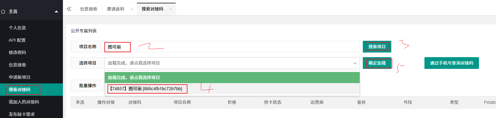
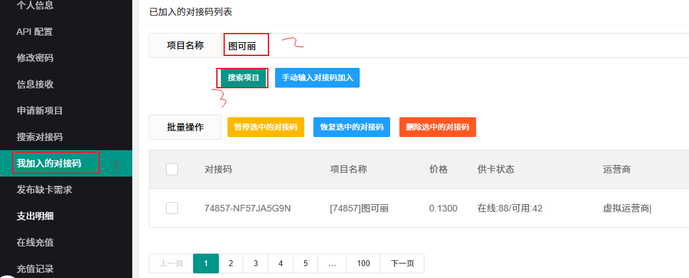
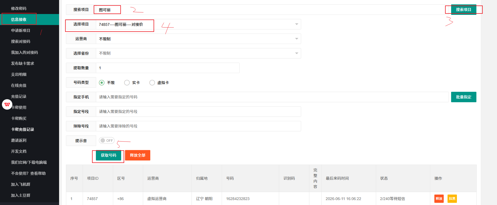

# day28-平台政策解析/确权和发行 - .md

主流的变现方式：

- 张三成立了一家短剧公司，张三可以搞短剧的承制
  - 张三会有独立的ip和版权
  - 短剧下派/外包
    - 按照分钟收费
    - 某宝、红书
- 自己起号，基于流量/广告变现
  - 1、2、或者3分钟的视频。
  - 视频中可以插入广告
- 上剧

## 课程前言

本节课核心解决所有个人AI漫剧创作者的**最大痛点**：网传授权入口失效、操作流程虚假、分不清真实可授权渠道、申请屡屡被拒、签约踩版权坑、授权后不懂制作上线规则。

本节课所有内容均为**2026年10月官网实测核验、100%可落地操作**，彻底删除往期虚假入口、失效流程、不实政策，全程适配**零基础个人创作者**（无公司、无营业执照、无团队资质），手把手实现正规拿IP、合规做漫剧、合法上线变现。

**核心通识结论（真实可查）**：番茄、七猫、阅文、书旗四大平台，**仅开放AI漫剧非独家授权给个人**，独家授权仅对机构/成熟工作室开放；个人无需挂靠任何团队，实名即可申请合规授权。

## 一、课前必备：个人申请通用全套材料（必准备，审核硬性要求）

所有平台授权审核核心只看两点：**身份真实可查 + 具备成熟漫剧制作能力**，无材料直接驳回，以下为全平台通用必备材料：

1. **身份资质材料**：本人身份证正反面照片、平台账号实名认证（纯个人实名，无需企业资质、无需对公账户）
2. **能力证明材料（审核核心）**：1–3集**竖屏动态漫样片**（720P以上，必须是动态漫）、3–5集精简剧本片段
3. **改编方案材料**：清晰写明目标小说改编方向、画风定位、剧情取舍逻辑、完整制作周期
4. **基础联系方式**：常用手机号、邮箱、个人创作账号（抖音/对应小说平台账号）

## 二、四大头部平台 官方真实授权流程（2026实测可操作，无虚假入口）

彻底修复往期失效网址、虚假板块、错误流程，以下为各平台**唯一正规、实测可通**的操作路径。

### （一）番茄小说｜字节跳动系（新手唯一首选，零门槛、高分成）

**真实平台优势**：个人门槛最低、无授权费、无保证金、免费开放海量可改编IP、创作者最高90%流水分成、抖音全域流量分发，审核时效快、容错率高

**适配人群**：所有零基础个人新手、兼职创作者、零基础起号变现人群

**官方唯一有效后台**：https://www.shortdramas.com/（抖音短剧创作者中心，实测可正常访问）

**重要纠错（修复往期虚假流程）**：该平台**无独立“漫剧专区”自助选IP入口**，往期后台直接选IP的流程已全面失效，目前个人统一为【IP报备申请制】

**2026最新真实完整实操步骤**：

电脑端打开官网，抖音扫码快捷登录，完成个人实名认证（必须本人实名，不可借用他人账号）；

后续可以查看【短剧版权中台成品漫剧业务介绍及合作指引】链接是：https://bytedance.larkoffice.com/docx/Cj0tdtPYwoqzdAxsjYmcdWCynff

然后重点查看合作指引中的【合作模式二】

| 模式二：番茄IP改编合作 | 对公机构/个人达人 | 免费+付费首发 | 番茄IP参投 | 5年  | 免费：特定单价付费：付费小程序充值金额6% | 模式简介：我方提供IP、贵方改编漫剧，版权共有、依约分发、收益互相分成合作数量：月产能至少10集 分成期限：永久 作品总时长要求： - 长篇小说IP：表情包/沙雕/简笔画漫剧/传统动态漫/AIGC/3D漫剧单部**120分钟**起。 - 短篇小说IP无特定时长要求，可依据小说篇幅来自行判断。 分发限制：由我方负责**全渠道分发运营**及转免节奏，助益贵方收益最大化（协议另有约定的除外） 合作授权地区：全球范围 **特别说明：提报后不得中途放弃改编，否则贵方仍须支付IP改编费，以保障IP权利人的权益 番茄ip内容不可用于制作AIGC推书视频、解说漫剧** |
| ---------------------- | ----------------- | ------------- | ---------- | ---- | ---------------------------------------- | ------------------------------------------------------------ |
|                        |                   |               |            |      |                                          |                                                              |

合作模式二的合作流程：

| **步骤**             | **操作示意图/文档**                                          | **备注**                                                     |
| :------------------- | :----------------------------------------------------------- | :----------------------------------------------------------- |
| **注册认证**         | **[短剧创作者中心\|版权方操作手册 【漫剧】 - 短剧创作者中心](https://support.oceanengine.com/support/content/207460?mappingType=2&spaceId=467&timestamp=1776067635012)** | 注册认证详细操作见第2、3部分；                               |
| **申请开通后台IP库** | [抖音短剧版权中心漫剧线上IP库开通申请表](https://bytedance.larkoffice.com/share/base/form/shrcn0StzcMvSsGF5gdrKnks7Re) | **如之前已与版权中台签约模式二合同的，会自动打开IP库，无需再次申请开通** 如之前没有签约模式二或模式三合同的，需要填写IP库开通申请表申请开通后台IP库功能，首次申请须知： - 需先行随意挑选1部番茄IP进行demo制作，通过质量评估后方可开通IP库功能； 用于制作demo的番茄IP，不代表后续可继续开发，如成功开通IP库，则需在后台IP库里重新选择IP进行确权后方可改编 - 如开通IP库申请成功，**7个工作日**推送IP改编合同到后台 - 合同是按模式签约，不是按照剧签约 - 主合同为框架空合同，没有具体ip和漫剧书单，主合同内IP名和作者可填“/”，在后台IP库中成功申请IP后会自动下发补充协议作为授权证明，补充协议无需您签约。 |
| **挑选IP**           | [ 【漫剧】IP改编权申请说明 -版权中心](https://bytedance.larkoffice.com/wiki/Gcdcw8jVlicdh7k1t0KcEyqKnWc) | 请仔细阅读👈的文档                                            |
| **内容上传审核**     | [漫剧权利材料提交指南](https://bytedance.larkoffice.com/wiki/ROGSwn5TLi6ItnktHhXc1cvfnke) | 内容上传详细操作见 版权方操作手册【漫剧】第5部分； 承诺总集数不支持修改，是整部剧的集数。「连载中」的漫剧，上传至承诺总集数后，自动变更为「已完结」上传入口将关闭，不支持新增上传 是否AI作品按实际填写，使用ai工具制作就选“是”，后续不支持修改 制作好的漫剧需严格选择之前对应挑选的番茄IP进行关联 绑定合同选择**漫剧IP授权合作协议（对公/对私签约-纯分成-漫剧版权共有）-主协议** 模式二仅可绑定【是否番茄ip改编为“是” 】的漫剧！！！ 权属文件参考权利材料提交指南，ip授权补充协议后续会陆续推送 不侵权承诺函通用，不区分个人还是公司 |
| **原生经营+投流**    | [抖音集团短剧版权中心-漫剧操作指南](https://bytedance.larkoffice.com/docx/LvXZdfsgEoorHmxh0iocGz0BnCh?from=from_copylink)[抖音集团短剧版权中心-抖音原生投流能力介绍](https://bytedance.larkoffice.com/wiki/HyAnwere2iNYVak7b1oc3pWEnRg) | 抖音原生经营详细操作见漫剧操作指南第7部分；                  |
| **结算**             | [抖音集团短剧版权中心-漫剧操作指南](https://bytedance.larkoffice.com/docx/LvXZdfsgEoorHmxh0iocGz0BnCh)-结算提现 | 作品上架之后，**次月第10个工作日**，结算数据会发送至版权中心后台，请自行查看并申请打款，若结算单和发票信息无误，**20个工作日进行付款** 注：开票类型为无形资产*版权 或者 现代服务*版权 发票中备注一栏，如无必要，无需填写！ |
| ⚠️特殊情况            | 由于IP申请量有限额，超出限额的IP可以自行通过番茄原创版权商务进行采买，自行采买的IP改编而成的剧上传路径与上述不一致采买入口：[动态漫改编权-合作SOP TO 合作方](https://bytedance.larkoffice.com/docx/WQFkdend1o0SnRxOYkTcPEeAn6g) | **您方自行购买后的ip剧上传路径为**： 是否ip改编：填【否】如果是模式三框架合作，填完否之后绑框架合同； 如果非模式三框架合作，这类内容请绑定与番茄原创签约的IP采买合同，**不要绑模式一或者模式二ip参投合同** |

### （二）七猫小说｜百度系（AI工具最全，精细化制作首选）

**真实平台优势**：百度信息流精准流量扶持，审核规则稳定，适合做精品漫剧

**适配人群**：擅长AI精细化制作、追求画面质感、想靠官方工具降本增效的个人创作者

纠正一个全网错误认知：七猫作家中心没有个人自助授权专区，不能自己点击申请拿授权，所有个人授权统一为人工报备审核制。

https://www.qimao.com/contact

### （三）阅文｜起点中文网｜腾讯系（精品IP最多、爆款潜力最大）

**真实平台优势**：全网顶级精品网文IP储备，拥有十万+可改编优质IP，配套专属AI漫剧创作助手，优质作品可拿保底+爆款奖励

**适配人群**：有1-2部漫剧制作经验、想做精品长剧、冲击爆款收益的进阶创作者

**双官方实测有效入口**：      

1. 合作签约后台：https://nova.yuewen.com/（漫剧合作签约、权限开通）   

   公告中心：https://nova.yuewen.com/notice   

   达人公告手册：https://docs.qq.com/doc/DQ3BWR1ZhZVhsQ01R

2. AI制作工具后台：https://aicomic.yuewen.com/（小说改漫剧全流程AI工具）    

**完整真实实操步骤**：

https://docs.qq.com/doc/DQ3BWR1ZhZVhsQ01R

**真实重点提示**：阅文审核标准为四大平台最高，新手无作品经验、无优质样片，大概率直接驳回，建议积累基础经验后再入驻。

### （四）书旗小说｜阿里系（高分成、小众精品IP多）

**真实平台优势**：个人分成比例80%-90%，小众优质IP竞争小、出圈概率高，阿里文娱全渠道分发

**适配人群**：制作稳定、追求高单作品收益的成熟个人创作者

漫剧启航计划：https://ognv.shuqi.com/comic/rule#contact-us

# day28-平台政策解析/虚拟手机号收验证码/操作.md

### 整体思路

- 登录下面手机号网站，按照提示操作，就可以通过多个手机号注册相关平台。（每个手机号接收短信费用目前大概0.1-2元左右）

  - 手机号网站（能接受验证码的虚拟手机号网站）

    - https://h5.haozhuma.com/reg.html?action=bobo328410948

  - 注册成功后登录：https://h5.haozhuma.com/login.php

    - 选择【搜索对接码】，项目名称输入“图可丽”然后搜索（需要至少充值1-5元），然后选择项目【74857】图可丽，点击确认加载即可：

  
    
  
  - 然后自行选择添加接受短信价格比较便宜的对接码，选择完成后点击【加入对接码】
  
  - 点击【我加入的对接码】，项目名称搜索【图可丽】，点击搜索项目就可以看到刚才加入的对接码
  
    
  
  - 点击【信息接收】搜索项目，项目名称是【图可丽】你就会得到一个用来接受短信的号码
  
    
  
  - 打开相关网站，注册输入上一步得到的手机号，点击获取验证码，然后等待上一步页面中生成验证码，该验证码用于网站注册即可。
